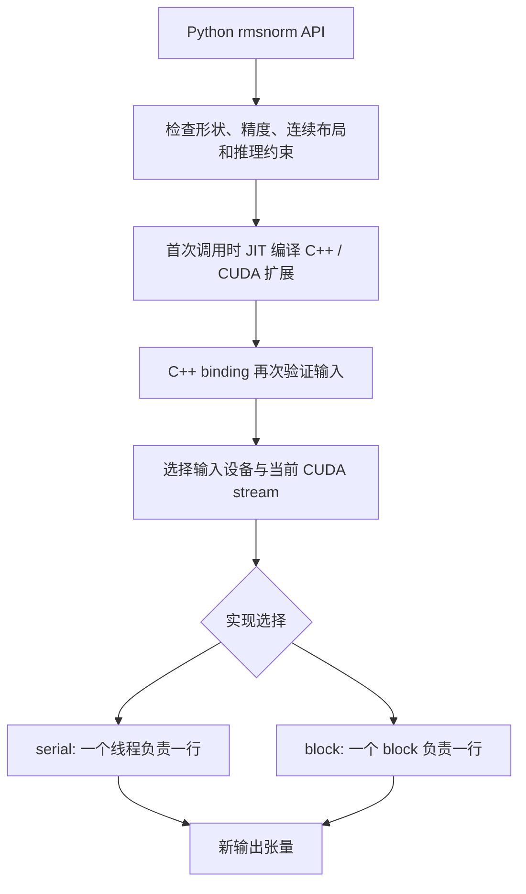

# 第一阶段：从公式到 CUDA 线程映射

这一阶段先理解、检查已有实现，不增加未经测量的新优化。没有 GPU 也能完成前两步；第三步是代码阅读，不能代替真实 GPU 验证。

## 1. 用 CPU 看清每一步计算

安装 README 中的 CPU 环境后运行：

```bash
python -m rmsnorm_lab.lesson
python -m pytest -q -ra
```

RMSNorm 沿最后一维归一化。它不减均值，这一点与 LayerNorm 不同。

以一行 `[3, 4]` 为例，平方均值是 `(9 + 16) / 2 = 12.5`。先乘 `1 / sqrt(12.5 + eps)`，再分别乘 weight 的对应元素。eps 使全零输入不会除以零；weight 让模型可以学习每个通道的缩放。

`reference()` 先把输入转换为 FP32，再平方、归约和缩放，最后转换回原精度。这避免直接以 FP16 做平方和，但并不保证任意极端输入都不会溢出。

残差模式先执行 `x + residual`，舍入到输入精度，再进入 RMSNorm。CUDA 中的显式类型转换是为了保持这一语义，而不是无意义的转换。若改成全程 FP32 保留残差和，数值定义就变化了。

**独立修改练习：** 把 lesson 中 weight 改成 `[1, 1]`，先手算第一行输出；再把输入换成 `[0, 0]`，说明 eps 的作用。最后把 eps 改成 `1e-2`，预测输出变化后再运行。

## 2. 从 Python 调用追踪到 kernel



- `ops.py`：定义 API 和参考语义。这里拒绝非连续输入，避免隐式拷贝掩盖成本。
- `bindings.cpp`：Python 之外仍可直接调用原生入口，因此 C++ 侧也必须检查边界。
- `kernels.cu`：真正的设备计算。device guard 使张量位于非当前 GPU 时仍在正确设备启动；current stream 使调用遵守上游操作的执行顺序。
- `benchmark.py`：在 JIT 编译和数值检查完成后再计时。

**自检：** 为什么导入包不应立即编译？为什么 Python 检查不能取代 C++ 检查？为什么不能悄悄把非连续输入变成连续输入再宣称算子很快？

## 3. 理解两个 CUDA 实现

### 串行基线

`serial_kernel` 中，每个线程负责一整行，顺序累加 hidden 个平方值，再顺序写输出。实现直观，但一行没有利用多个线程归约；相邻线程访问不同的行，在 hidden 较大时访问地址相距很远。

这个版本是教学基线。战胜它并不代表战胜成熟实现。

### block 版本

以 hidden=1025、256 个线程为例：

- 线程 0 读取列 `0, 256, 512, 768, 1024`。
- 线程 1 读取列 `1, 257, 513, 769`。
- 同一轮相邻线程读取相邻元素，有利于合并访存。
- 每个线程把局部平方和保存在寄存器。
- 每个 warp 内用 shuffle 归约，8 个 warp 各产生一个部分和。
- 8 个部分和写入共享内存，第一次 `__syncthreads()` 确保其他 warp 写完。
- 第一个 warp 汇总它们，线程 0 写入共享的 inverse RMS。
- 第二次 `__syncthreads()` 确保所有线程读取已写好的 inverse RMS，然后写输出。

full warp mask 合法的原因：block 大小是 256，即完整的 8 个 warp；第一次所有线程参加 shuffle；第二次恰好第一个完整 warp 参加。没有数据的线程也以零参与，不会提前退出。

**自检：** hidden 小于 32 时为什么仍然正确？把 block 大小随意改成 100 会破坏哪些假设？删除任意一次 block 同步为什么可能出现竞争？

不要在正式 kernel 中留下故意的 bug。若要练习定位同步问题，先复制到独立练习分支，并在 GPU 上使用 compute-sanitizer 验证。

## 4. 尚未证实的优化假设

- block 并行归约是否更快，以及在哪些尺寸上更快，需要测量。
- residual 融合省去一个中间张量和一次独立 add launch，但两遍读取会重复执行相加。
- 缓存中间值可能减少读取，也可能增加寄存器压力甚至 spill。
- 小 hidden 可能更适合一个 warp 处理一行，但当前不在没有 profile 的情况下加入该策略。

得到 GPU 后，先编译并运行完整测试，再跑小范围基准，最后才改变实现。不要把这里的推测写成性能结论。
